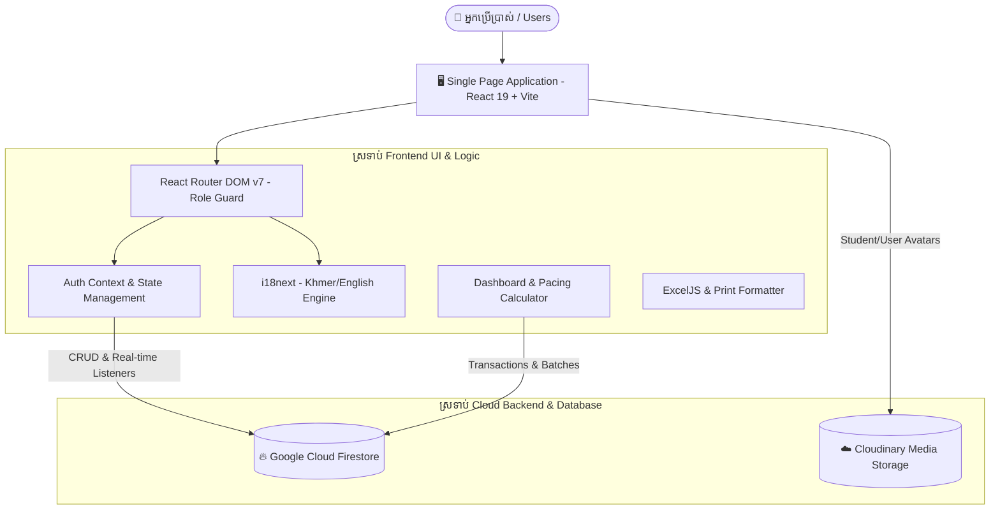

# 🎓 ប្រព័ន្ធគ្រប់គ្រងវត្តមានសិស្ស - ESD Attendance System

> **Enterprise-Grade, Responsive, and Bilingual School Attendance Management Web Application**  
> Built with **React 19**, **Vite**, **TypeScript**, **Tailwind CSS**, and **Firebase Firestore**.

[](https://react.dev/)
[](https://www.typescriptlang.org/)
[](https://vitejs.dev/)
[](https://tailwindcss.com/)
[](https://firebase.google.com/)
[]()

---

## 📋 មាតិកា / Table of Contents

- [🌟 ទិដ្ឋភាពទូទៅនៃគម្រោង / Project Overview](#-ទិដ្ឋភាពទូទៅនៃគម្រោង--project-overview)
- [🏗️ ស្ថាបត្យកម្មប្រព័ន្ធ / System Architecture](#️-ស្ថាបត្យកម្មប្រព័ន្ធ--system-architecture)
- [🚀 កាតាឡុកលក្ខណៈពិសេសពេញលេញ / Comprehensive Feature Catalog](#-កាតាឡុកលក្ខណៈពិសេសពេញលេញ--comprehensive-feature-catalog)
  - [1. ផ្ផ្ទាំងគ្រប់គ្រងតាមតួនាទី (Role-Based Dashboard)](#1-ផ្ទាំងគ្រប់គ្រងតាមតួនាទី-role-based-dashboard---dashboard)
  - [2. ការផ្ទៀងផ្ទាត់ និងការគ្រប់គ្រងអ្នកប្រើប្រាស់ (Auth & RBAC)](#2-ការផ្ទៀងផ្ទាត់-និងការគ្រប់គ្រងអ្នកប្រើប្រាស់-auth--rbac---users-login)
  - [3. ការគ្រប់គ្រងសិស្ស និងការចុះឈ្មោះ (Student & Enrollment Management)](#3-ការគ្រប់គ្រងសិស្ស-និងការចុះឈ្មោះ-student--enrollment-management---students)
  - [4. កញ្ចប់សិក្សា មុខវិជ្ជា និងម៉ូឌុល (Packages, Subjects & Modules)](#4-កញ្ចប់សិក្សា-មុខវិជ្ជា-និងម៉ូឌុល-packages-subjects--modules---packages-subjects)
  - [5. ការគ្រប់គ្រងថ្នាក់រៀន (Classroom Lifecycle Management)](#5-ការគ្រប់គ្រងថ្នាក់រៀន-classroom-lifecycle-management---classes)
  - [6. ការស្រង់វត្តមានប្រចាំថ្ងៃ និងច្បាប់ចាក់សោម៉ោង (Daily Attendance & Session Locking)](#6-ការស្រង់វត្តមានប្រចាំថ្ងៃ-និងច្បាប់ចាក់សោម៉ោង-daily-attendance--session-locking---attendance)
  - [7. សង្ខេបវត្តមានប្រចាំថ្ងៃទូទាំងសាលា (Daily Attendance Summary)](#7-សង្ខេបវត្តមានប្រចាំថ្ងៃទូទាំងសាលា-daily-attendance-summary---daily-attendance-summary)
  - [8. របាយការណ៍វត្តមានប្រចាំខែ និងទម្រង់បោះពុម្ព (Monthly Attendance Matrix & Print View)](#8-របាយការណ៍វត្តមានប្រចាំខែ-និងទម្រង់បោះពុម្ព-monthly-attendance-matrix--print-view---attendance-reports)
  - [9. ប្រវត្តិវត្តមានសិស្សម្នាក់ៗ (Student Attendance History & Profiles)](#9-ប្រវត្តិវត្តមានសិស្សម្នាក់ៗ-student-attendance-history--profiles---student-attendance)
  - [10. របាយការណ៍អវត្តមាន និងមកយឺត + Excel Export (Absence & Late Analytics)](#10-របាយការណ៍អវត្តមាន-និងមកយឺត--excel-export-absence--late-analytics---absence-late-report)
  - [11. របាយការណ៍វឌ្ឍនភាពថ្នាក់រៀន + Excel Export (Class Progress & Curriculum Pacing)](#11-របាយការណ៍វឌ្ឍនភាពថ្នាក់រៀន--excel-export-class-progress--curriculum-pacing---class-progress-report)
  - [12. ការគ្រប់គ្រងថ្ងៃឈប់សម្រាក និងការបិទសាលា (School Holidays & Closure Automation)](#12-ការគ្រប់គ្រងថ្ងៃឈប់សម្រាក-និងការបិទសាលា-school-holidays--closure-automation---holidays)
  - [13. ការកែតម្រូវវត្តមាន និងកំណត់ហេតុសវនកម្ម (Attendance Corrections & Immutable Audit Log)](#13-ការកែតម្រូវវត្តមាន-និងកំណត់ហេតុសវនកម្ម-attendance-corrections--immutable-audit-log---attendance-corrections)
  - [14. ការកំណត់ប្រព័ន្ធ និងការផ្ទុករូបភាព (System Settings & Media Upload)](#14-ការកំណត់ប្រព័ន្ធ-និងការផ្ទុករូបភាព-system-settings--media-upload---settings)
  - [15. ប្រព័ន្ធពហុភាសា (Bilingual Localization - Khmer & English)](#15-ប្រព័ន្ធពហុភាសា-bilingual-localization---khmer--english)
- [👥 តារាងសិទ្ធិប្រើប្រាស់តាមតួនាទី / RBAC Permission Matrix](#-តារាងសិទ្ធិប្រើប្រាស់តាមតួនាទី--rbac-permission-matrix)
- [🗄️ រចនាសម្ព័ន្ធទិន្នន័យ Firestore / Firestore Data Schemas](#️-រចនាសម្ព័ន្ធទិន្នន័យ-firestore--firestore-data-schemas)
- [🛠️ បច្ចេកវិទ្យាប្រើប្រាស់ / Technology Stack](#️-បច្ចេកវិទ្យាប្រើប្រាស់--technology-stack)
- [📂 រចនាសម្ព័ន្ធគម្រោង / Project Structure](#-រចនាសម្ព័ន្ធគម្រោង--project-structure)
- [🚀 ការដំឡើង និងដំណើរការ / Getting Started](#-ការដំឡើង-និងដំណើរការ--getting-started)
- [⚙️ អថេរប្រព័ន្ធ / Environment Variables](#️-អថេរប្រព័ន្ធ--environment-variables)
- [📦 ការបង្កើត Production Build / Build & Deployment](#-ការបង្កើត-production-build--build--deployment)

---

## 🌟 ទិដ្ឋភាពទូទៅនៃគម្រោង / Project Overview

**ESD Attendance System** គឺជាប្រព័ន្ធគ្រប់គ្រង និងតាមដានវត្តមានសិស្សពេញលេញកម្រិត Enterprise ដែលត្រូវបានរចនាឡើងយ៉ាងពិសេសសម្រាប់គ្រឹះស្ថានអប់រំ និងសាលារៀននៅកម្ពុជា។ ប្រព័ន្ធនេះផ្តល់នូវដំណោះស្រាយឌីជីថលបែបទំនើប ជំនួសការកត់ត្រាវត្តមានលើក្រដាសបុរាណ ដោយភ្ជាប់ទំនាក់ទំនងរវាង **គណៈគ្រប់គ្រង (Administration)** និង **លោកគ្រូ-អ្នកគ្រូ (Teachers)** ក្នុងពេលវេលាជាក់ស្តែង (Real-time Synchronization)។

### ចំណុចលេចធ្លោសំខាន់ៗ (Key Highlights):
- 🇰🇭 **គាំទ្រភាសាខ្មែរ ១០០%**: រចនាឡើងជាមួយពុម្ពអក្សរជាតិ `Kantumruy Pro` រួមជាមួយការបកប្រែជាភាសាអង់គ្លេសទ្វេភាសាភ្លាមៗ (Instant Live Toggle)។
- ⏰ **ពេលវេលាកម្ពុជាច្បាស់លាស់ (UTC+7 Phnom Penh)**: រាល់ការគណនាថ្ងៃខែ ម៉ោងបង្រៀន និងច្បាប់ចាក់សោវត្តមាន (Session Locking) ដំណើរការផ្អែកលើ Timezone ផ្លូវការរបស់កម្ពុជាជានិច្ច។
- 🔒 **សុវត្ថិភាពទិន្នន័យ និងសវនកម្ម (Immutable Audit Trail)**: ការកែប្រែទិន្នន័យវត្តមានជាប្រវត្តិសាស្រ្តត្រូវតែឆ្លងកាត់ដំណើរការ Atomic Transaction ជាមួយមូលហេតុច្បាស់លាស់ និងរក្សាទុកកំណត់ហេតុសវនកម្មដែលមិនអាចកែប្រែបាន។
- 📊 **របាយការណ៍ស៊ីជម្រៅ & Export Excel**: របាយការណ៍អវត្តមានសិស្ស, ការមកយឺត, វឌ្ឍនភាពថ្នាក់រៀន, ម៉ាទ្រីសវត្តមានប្រចាំខែ ដែលអាចទាញយកជាឯកសារ Excel (.xlsx) ជាមួយស្ទីលតុបតែងក្បាលតារាង ឬបោះពុម្ពជាក្រដាស A4 យ៉ាងស្អាត។

---

## 🏗️ ស្ថាបត្យកម្មប្រព័ន្ធ / System Architecture



---

## 🚀 កាតាឡុកលក្ខណៈពិសេសពេញលេញ / Comprehensive Feature Catalog

### 1. ផ្ទាំងគ្រប់គ្រងតាមតួនាទី (Role-Based Dashboard - `/dashboard`)
ផ្ទាំង Dashboard បង្ហាញទិន្នន័យឆ្លាតវៃតាមតួនាទីរបស់អ្នកប្រើប្រាស់ជាក់ស្តែង៖
- **សម្រាប់ Admin & Super Admin**:
  - **ប័ណ្ណសូចនាករសំខាន់ៗ (KPI Summary Cards)**: សិស្សសរុប (Total Students), ថ្នាក់រៀនកំពុងដំណើរការ (Active Classes), គ្រូបង្រៀនសកម្ម (Active Teachers), អត្រាវត្តមានសរុប (Overall Attendance Rate), និងចំនួនថ្ងៃឈប់សម្រាកក្នុងខែ (Holidays)។
  - **ស្ថានភាពប្រតិបត្តិការសាលា (School Operational Health)**: ប្រព័ន្ធវិភាគ និងវាយតម្លៃសុខភាពទូទៅ (`ល្អប្រសើរ / Good`, `ធម្មតា / Normal`, `ត្រូវការការយកចិត្តទុកដាក់ / Needs Attention`) ដោយស្វ័យប្រវត្តិ។
  - **ទិដ្ឋភាពទូទៅនៃវត្តមានថ្ងៃនេះ (Today's Attendance Overview)**: គំនូសតាងស្ថិតិ និងចំនួនសរុបនៃសិស្ស វត្តមាន, អវត្តមាន, ច្បាប់, និងយឺត។
  - **បញ្ជីស្ថានភាពវត្តមានតាមថ្នាក់ (Class Attendance Status List)**: បង្ហាញគ្រប់ថ្នាក់រៀនក្នុងថ្ងៃនេះ ជាមួយ Badge បញ្ជាក់ស្ថានភាព (`មិនទាន់ស្រង់ / Not Marked`, `កំពុងស្រង់ / In Progress`, `បានស្រង់រួចរាល់ / Completed`), អត្រាសិស្សមានវត្តមាន, និងប៊ូតុងចុចស្រង់វត្តមានភ្លាមៗ។
  - **ផ្ទាំងប្រកាសអាសន្ន និងការយកចិត្តទុកដាក់ (Attention Panel)**: ជូនដំណឹងបន្ទាន់អំពីថ្នាក់រៀនដែលមិនទាន់បានស្រង់វត្តមាន និងថ្នាក់រៀនដែលមានអត្រាវត្តមានទាបជាង ៧០%។
  - **សកម្មភាពរហ័ស (Quick Navigation Actions)**: ផ្លូវកាត់សម្រាប់ចុះឈ្មោះសិស្សថ្មី, បង្កើតថ្នាក់រៀន, មើលរបាយការណ៍សង្ខេប, និងពិនិត្យកំណត់ហេតុសវនកម្ម។
- **សម្រាប់គ្រូបង្រៀន (Teacher Dashboard)**:
  - **ស្ថិតិថ្នាក់ផ្ទាល់ខ្លួន**: ចំនួនសិស្សក្នុងបន្ទុក, ចំនួនថ្នាក់ទទួលបន្ទុក, ថ្នាក់ត្រូវបង្រៀនថ្ងៃនេះ, និងអត្រាវត្តមានជាមធ្យម។
  - **ប័ណ្ណថ្នាក់រៀនបន្ទាប់ (Next Upcoming Class Card)**: រំលេចថ្នាក់ដែលត្រូវបង្រៀនបន្ទាប់ ជាមួយម៉ោងចាប់ផ្តើម និងប៊ូតុងចុះឈ្មោះស្រង់វត្តមាន។
  - **កាលវិភាគបង្រៀនថ្ងៃនេះ (Today's Teaching Schedule)**: បញ្ជីថ្នាក់តាមលំដាប់លំដោយម៉ោងបង្រៀន ព្រមទាំងស្ថានភាពស្រង់វត្តមានជាក់ស្តែង។

---

### 2. ការផ្ទៀងផ្ទាត់ និងការគ្រប់គ្រងអ្នកប្រើប្រាស់ (Auth & RBAC - `/users`, `/login`)
- **ប្រព័ន្ធការពារផ្លូវ (Route Guards)**: ការពារ URL ទាំងអស់តាមរយៈ `ProtectedRoute` ដោយផ្ទៀងផ្ទាត់តួនាទីយ៉ាងតឹងរ៉ឹង។
- **Quick Demo Account Switcher**: ផ្តល់ភាពងាយស្រួលក្នុងការសាកល្បងដោយចុចមួយឃ្លីក (Super Admin, Admin, Teacher Demo)។
- **ការគ្រប់គ្រងគណនីបុគ្គលិក**:
  - បង្កើត កែប្រែ ផ្អាកដំណើរការ (Deactivate) និងលុបគណនី។
  - កំណត់តួនាទី (`super_admin`, `admin`, `teacher`)។
  - ចាត់តាំងថ្នាក់រៀនទទួលបន្ទុកសម្រាប់គ្រូនីមួយៗ (Assigned Classrooms)។
  - **វិធានសុវត្ថិភាពចម្បង**: មិនអនុញ្ញាតឱ្យលុបគណនីខ្លួនឯង, មិនអាចបង្កើត ឬលុប `super_admin` តាមរយៈ UI ឡើយ។

---

### 3. ការគ្រប់គ្រងសិស្ស និងការចុះឈ្មោះ (Student & Enrollment Management - `/students`)
- **ទម្រង់ចុះឈ្មោះ ៣ ដំណាក់កាល (3-Step Enrollment Wizard)**:
  1. **ព័ត៌មានទូទៅ (General Info)**: អត្តលេខសិស្ស (Student Code), ឈ្មោះខ្មែរ-ឡាតាំង, ភេទ, ថ្ងៃខែឆ្នាំកំណើត, ស្ថានភាពសំបុត្រកំណើត (មាន/គ្មាន), លេខទូរស័ព្ទ, រូបថតសិស្ស (Upload ទៅ Cloudinary)។
  2. **អាសយដ្ឋានបច្ចុប្បន្ន (Address Details)**: ភូមិ, ឃុំ/សង្កាត់, ស្រុក/ខណ្ឌ, ខេត្ត/រាជធានី។
  3. **ព័ត៌មានគ្រួសារ និងអាណាព្យាបាល (Family & Guardian)**: ឈ្មោះ និងមុខរបរឪពុក, ឈ្មោះ និងមុខរបរម្តាយ, លេខទូរស័ព្ទអាណាព្យាបាលទំនាក់ទំនងបន្ទាន់។
- **ប្រវត្តិការសិក្សា និងការផ្ទេរថ្នាក់ (Enrollment & Transfers)**:
  - កត់ត្រាកាលបរិច្ឆេទចុះឈ្មោះ (Enrollment Date), កញ្ចប់សិក្សាដែលបានជ្រើសរើស, ថ្នាក់រៀនបច្ចុប្បន្ន។
  - គាំទ្រការផ្ទេរសិស្សរវាងថ្នាក់រៀន (Class Transfer) ដោយរក្សាទុកប្រវត្តិរៀនចាស់។
- **ទំព័រប្រវត្តិរូបសិស្សពេញលេញ (Student Profile & Detail View)**: ពិនិត្យមើលព័ត៌មានសិស្សគ្រប់ជ្រុងជ្រោយ រួមទាំងស្ថិតិវត្តមានសរុប។

---

### 4. កញ្ចប់សិក្សា មុខវិជ្ជា និងម៉ូឌុល (Packages, Subjects & Modules - `/packages`, `/subjects`)
- **កញ្ចប់សិក្សា (`/packages`)**: បង្កើតកញ្ចប់វគ្គសិក្សា (ឧទាហរណ៍៖ វគ្គកុំព្យូទ័ររដ្ឋបាល, ភាសាអង់គ្លេសទូទៅ) កំណត់តម្លៃសិក្សា, រយៈពេលសិក្សាគិតជាខែ, ចំនួនម៉ោងសរុប, និងការពិពណ៌នា។
- **មុខវិជ្ជា (`/subjects`)**: កូដមុខវិជ្ជា, ឈ្មោះមុខវិជ្ជា, ចំនួនម៉ោងបង្រៀនសរុប (Total Hours), និងការចាត់តាំងម៉ូឌុលមេរៀន។
- **ម៉ូឌុលសិក្សា (Course Modules)**: រៀបចំលំដាប់លំដោយមេរៀន និងចំនួនម៉ោងជាក់ស្តែងតាមមុខវិជ្ជានីមួយៗ។

---

### 5. ការគ្រប់គ្រងថ្នាក់រៀន (Classroom Lifecycle Management - `/classes`)
- បង្កើតថ្នាក់រៀនថ្មី កំណត់កូដថ្នាក់, ឈ្មោះថ្នាក់, កញ្ចប់សិក្សា/មុខវិជ្ជា, គ្រូទទួលបន្ទុក, និងចំនួនកៅអីអតិបរមា។
- **កាលវិភាគបង្រៀន (Schedule Configuration)**: កំណត់ថ្ងៃសិក្សា (ច័ន្ទ-សុក្រ ឬ សៅរ៍-អាទិត្យ) និងចន្លោះម៉ោងសិក្សា (ឧទាហរណ៍៖ `08:00 - 10:00`, `14:00 - 16:00`)។
- **ទំព័រព័ត៌មានលម្អិតថ្នាក់រៀន (Classroom Detail)**:
  - បញ្ជីរាយនាមសិស្សកំពុងរៀនជាក់ស្តែង។
  - អត្រាវត្តមានសរុបរបស់ថ្នាក់។
  - វឌ្ឍនភាពនៃការបង្រៀនប្រៀបធៀបនឹងម៉ោងសរុបក្នុងកញ្ចប់សិក្សា។

---

### 6. ការស្រង់វត្តមានប្រចាំថ្ងៃ និងច្បាប់ចាក់សោម៉ោង (Daily Attendance & Session Locking - `/attendance`)
- **ការជ្រើសរើសថ្នាក់ និងកាលបរិច្ឆេទ**: ច្រោះតាមកាលបរិច្ឆេទ និងថ្នាក់រៀន (គ្រូឃើញតែថ្នាក់ដែលខ្លួនទទួលបន្ទុក)។
- **ស្ថានភាពវត្តមាន ៤ ប្រភេទ**:
  - 🟢 **វត្តមាន (Present)**
  - 🔴 **អវត្តមាន (Absent)**
  - 🟡 **យឺត (Late)**
  - 🔵 **ច្បាប់ (Permission)**
- **មុខងាររហ័ស**: ប៊ូតុង "វត្តមានទាំងអស់" (Mark All Present) ជួយកាត់បន្ថយពេលវេលាស្រង់វត្តមានមកត្រឹមប៉ុន្មានវិនាទី។
- **កំណត់សម្គាល់បន្ថែម (Remarks)**: កត់ត្រាមូលហេតុនៃការសុំច្បាប់ ឬការមកយឺតសម្រាប់សិស្សនីមួយៗ។
- **ច្បាប់ចាក់សោម៉ោងស្រង់វត្តមាន (Cambodia Time Session Locking)**:
  - ការពារមិនឱ្យស្រង់វត្តមានមុនម៉ោងសិក្សា ឬស្រង់វត្តមានសម្រាប់ថ្ងៃអនាគត។
  - ចាក់សោដោយស្វ័យប្រវត្តិប្រសិនបើផុតកំណត់ម៉ោងអនុញ្ញាត (Grace Period) ដើម្បីការពារការកែបន្លំ។
  - បញ្ជាក់ច្បាស់លាស់នៅពេលថ្ងៃដែលបានជ្រើសរើសត្រូវនឹងថ្ងៃឈប់សម្រាកផ្លូវការ (School Holiday Warning)។

---

### 7. សង្ខេបវត្តមានប្រចាំថ្ងៃទូទាំងសាលា (Daily Attendance Summary - `/daily-attendance-summary`)
- បង្ហាញតារាងសង្ខេបប្រតិបត្តិការប្រចាំថ្ងៃសម្រាប់គណៈគ្រប់គ្រងទូទាំងសាលា។
- បំបែកទិន្នន័យតាមវេនសិក្សា (Morning, Afternoon, Evening) និងតាមថ្នាក់រៀននីមួយៗ។
- បង្ហាញចំនួនសរុបនៃសិស្សវត្តមាន, អវត្តមាន, ច្បាប់, យឺត និងភាគរយវត្តមានសរុប។
- សូចនាករពណ៌បង្ហាញពីស្ថានភាពវត្តមាន (`ល្អ`, `មធ្យម`, `ខ្សោយ`)។

---

### 8. របាយការណ៍វត្តមានប្រចាំខែ និងទម្រង់បោះពុម្ព (Monthly Attendance Matrix & Print View - `/attendance-reports`)
- **តារាងម៉ាទ្រីសប្រតិទិនប្រចាំខែ (Monthly Calendar Grid Matrix)**:
  - បង្ហាញសិស្សទាំងអស់ក្នុងថ្នាក់ និងជួរឈរតាមថ្ងៃនីមួយៗនៃខែ (ថ្ងៃទី ១ ដល់ ៣១)។
  - កូដសញ្ញាសម្គាល់ស្ដង់ដារ៖
    - `P` (បៃតង) = វត្តមាន (Present)
    - `A` (ក្រហម) = អវត្តមាន (Absent)
    - `L` (លឿង) = យឺត (Late)
    - `E` (ខៀវ) = ច្បាប់ (Permission)
    - `H` (ប្រផេះ) = ថ្ងៃឈប់សម្រាក (Holiday)
    - `-` = គ្មានកាលវិភាគ
- **ទំព័របោះពុម្ពពេញទំហំ (Full-Width Print Layout)**:
  - ផ្លូវ Route ឯករាជ្យ `/attendance-reports/monthly/:classroomId/:yearMonth` គ្មាន Sidebar/Header រំខាន។
  - រៀបចំសម្រាប់បោះពុម្ពជាក្រដាស A4 Landscape ជាមួយ Header ផ្លូវការរបស់សាលា និងកន្លែងចុះហត្ថលេខាគ្រូទទួលបន្ទុក។

---

### 9. ប្រវត្តិវត្តមានសិស្សម្នាក់ៗ (Student Attendance History & Profiles - `/student-attendance`)
- **តារាងស្វែងរកសិស្ស**: ស្វែងរកតាមឈ្មោះ កូដសិស្ស ឬថ្នាក់រៀន ជាមួយការបង្ហាញអត្រាវត្តមានសរុបភ្លាមៗ។
- **ទំព័រប្រវត្តិក្បោះក្បាយ (Student Attendance Detail - `/student-attendance/:studentId`)**:
  - បង្ហាញបន្ទាត់ពេលវេលា (Timeline Log) នៃវត្តមានសិស្សគ្រប់ថ្ងៃសិក្សា។
  - ជម្រើសច្រោះតាមចន្លោះកាលបរិច្ឆេទ (Date Range Filter) និងស្ថានភាពវត្តមាន។
- **របាយការណ៍វត្តមានសិស្សប្រចាំខែ (Individual Monthly Preview)**:
  - ទម្រង់របាយការណ៍ `/student-attendance/:studentId/monthly/:yearMonth` សម្រាប់ផ្ញើជូនអាណាព្យាបាលសិស្ស។

---

### 10. របាយការណ៍អវត្តមាន និងមកយឺត + Excel Export (Absence & Late Analytics - `/absence-late-report`)
- **ការតាមដានសិស្សដែលមានហានិភ័យ (At-Risk Student Monitoring)**:
  - ស្វែងរក និងច្រោះសិស្សដែលឈប់លើសពីចំនួនកំណត់ (ឧទាហរណ៍៖ អវត្តមាន ≥ ៣ ដង ឬ យឺត ≥ ៣ ដង)។
  - ច្រោះតាមថ្នាក់រៀន និងតាមចន្លោះកាលបរិច្ឆេទជាក់លាក់។
- **ការនាំចេញជាឯកសារ Excel (.xlsx)**:
  - ដំណើរការតាមរយៈបណ្ណាល័យ `exceljs` ដោយផ្ទាល់លើ Browser។
  - ឯកសារ Excel មានរចនាបថស្អាតបាត: Header ពណ៌ខៀវដិត, ក្រឡាទិន្នន័យរៀបរយ, Auto-fit Column Width, និងការគណនាសរុបស្វ័យប្រវត្តិ។
- **ទម្រង់បោះពុម្ពផ្លូវការ (Print-Ready Page - `/absence-late-report/print`)**:
  - Layout សមស្របសម្រាប់បោះពុម្ពជូនគណៈគ្រប់គ្រងពិនិត្យ និងចាត់វិធានការលើសិស្ស។

---

### 11. របាយការណ៍វឌ្ឍនភាពថ្នាក់រៀន + Excel Export (Class Progress & Curriculum Pacing - `/class-progress-report`)
- **ការតាមដានការបង្រៀនជាក់ស្តែង (Curriculum Pacing & Completion Tracking)**:
  - គណនាចំនួនម៉ោង និងចំនួនមេរៀនដែលបានបង្រៀនជាក់ស្តែងធៀបនឹងកញ្ចប់សិក្សា។
  - របារវឌ្ឍនភាព (Progress Bar) និងការប៉ាន់ស្មានកាលបរិច្ឆេទបញ្ចប់វគ្គ (Estimated Completion Date)។
  - សូចនាករល្បឿនបង្រៀន (`ទាន់កាលវិភាគ / On Track`, `យឺតជាងកាលវិភាគ / Behind Schedule`, `លឿនជាងកាលវិភាគ / Ahead`)។
- **ការនាំចេញ Excel (.xlsx) & Print Preview (`/class-progress-report/print`)**:
  - នាំចេញរបាយការណ៍វឌ្ឍនភាពគ្រប់ថ្នាក់រៀនជាឯកសារ Excel ផ្លូវការ។

---

### 12. ការគ្រប់គ្រងថ្ងៃឈប់សម្រាក និងការបិទសាលា (School Holidays & Closure Automation - `/holidays`)
- បង្កើត កែប្រែ និងលុបថ្ងៃឈប់សម្រាកផ្លូវការរបស់ជាតិ ឬការបិទសាលារៀនពិសេស។
- កំណត់កាលបរិច្ឆេទចាប់ផ្តើម កាលបរិច្ឆេទបញ្ចប់ ឈ្មោះពិធីបុណ្យ (ខ្មែរ-អង់គ្លេស) និងមូលហេតុ។
- **ការតភ្ជាប់ជាមួយប្រព័ន្ធវត្តមានដោយស្វ័យប្រវត្តិ (Attendance Integration)**:
  - នៅពេលថ្ងៃនោះត្រូវនឹងថ្ងៃឈប់សម្រាក ប្រព័ន្ធនឹងសម្គាល់ដោយស្វ័យប្រវត្តិនូវស្ថានភាព `H` លើរបាយការណ៍ប្រចាំខែ។
  - បង្ហាញផ្ទាំង Alert ហាមឃាត់មិនឱ្យកត់ត្រាវត្តមាននៅថ្ងៃឈប់សម្រាក។

---

### 13. ការកែតម្រូវវត្តមាន និងកំណត់ហេតុសវនកម្ម (Attendance Corrections & Immutable Audit Log - `/attendance-corrections`)
- **ដំណើរការកែតម្រូវទិន្នន័យ (Correction Workflow)**:
  - អនុញ្ញាតឱ្យ Admin ឬ Super Admin កែប្រែស្ថានភាពវត្តមានដែលបានកត់ត្រារួចកាលពីអតីតកាល។
  - តម្រូវឱ្យបំពេញ **"មូលហេតុនៃការកែតម្រូវ" (Mandatory Reason)** ជាដាច់ខាត។
- **ប្រតិបត្តិការ Atomic Firestore Transaction**:
  - ធ្វើបច្ចុប្បន្នភាពឯកសារវត្តមានក្នុង `attendance` ដំណាលគ្នាជាមួយនឹងការកត់ត្រាចូល `attendance_audit_logs` ក្នុង Transaction តែមួយ (ធានាថាមិនមានការបាត់បង់ទិន្នន័យ ឬកត់ត្រាមិនត្រូវគ្នាឡើយ)។
- **កំណត់ហេតុសវនកម្មដែលមិនអាចកែប្រែបាន (Immutable Audit Log Viewer - `/attendance-audit-logs`)**:
  - បង្ហាញប្រវត្តិកែប្រែទាំងអស់៖ កាលបរិច្ឆេទកែ, អ្នកកែប្រែ, ស្ថានភាពចាស់ ➡️ ស្ថានភាពថ្មី, មូលហេតុ, និងថ្នាក់រៀន។
  - មិនមានប៊ូតុង Edit ឬ Delete លើកំណត់ហេតុសវនកម្មឡើយ ដើម្បីធានាតម្លាភាព និងភាពត្រឹមត្រូវ 100% សម្រាប់សវនករ។

---

### 14. ការកំណត់ប្រព័ន្ធ និងការផ្ទុករូបភាព (System Settings & Media Upload - `/settings`)
- កំណត់ព័ត៌មានទូទៅរបស់សាលា (ឈ្មោះសាលា, អាសយដ្ឋាន, លេខទូរស័ព្ទ, Email, Logo)។
- កំណត់កាលបរិច្ឆេទឆ្នាំសិក្សា និងឆមាស។
- កំណត់ម៉ោងអនុញ្ញាតឱ្យស្រង់វត្តមាន (Attendance Grace Period Minutes)។
- សមាហរណកម្ម Cloudinary សម្រាប់ Upload រូបថតសិស្ស និងបុគ្គលិកដោយផ្ទាល់។

---

### 15. ប្រព័ន្ធពហុភាសា (Bilingual Localization - Khmer & English)
- ប្តូរភាសាបានភ្លាមៗដោយគ្មាន Reload ទំព័រ (Instant Language Switching)។
- ឯកសារបកប្រែពេញលេញនៅ `src/i18n/locales/km.json` និង `src/i18n/locales/en.json`។
- រចនាបថ និងគម្លាតអក្សរត្រូវបានសម្រួលយ៉ាងពិសេសសម្រាប់តួអក្សរភាសាខ្មែរ មិនឱ្យជាន់គ្នា និងងាយស្រួលអានបំផុត។

---

## 👥 តារាងសិទ្ធិប្រើប្រាស់តាមតួនាទី / RBAC Permission Matrix

| ម៉ូឌុល និងមុខងារ (Feature / Route) | `super_admin` | `admin` | `teacher` |
|---|:---:|:---:|:---:|
| **ផ្ទាំង Dashboard (`/dashboard`)** | ✅ មើលឃើញគ្រប់ទិន្នន័យ | ✅ មើលឃើញគ្រប់ទិន្នន័យ | ✅ ឃើញតែថ្នាក់ក្នុងបន្ទុក |
| **គ្រប់គ្រងសិស្ស (`/students`)** | ✅ បង្កើត/កែ/លុប ពេញលេញ | ✅ បង្កើត/កែ/លុប ពេញលេញ | ❌ គ្មានសិទ្ធិចូល |
| **កញ្ចប់សិក្សា & មុខវិជ្ជា (`/packages`, `/subjects`)** | ✅ បង្កើត/កែ/លុប ពេញលេញ | ✅ បង្កើត/កែ/លុប ពេញលេញ | ❌ គ្មានសិទ្ធិចូល |
| **គ្រប់គ្រងថ្នាក់រៀន (`/classes`)** | ✅ បង្កើត/កែ/លុប ពេញលេញ | ✅ បង្កើត/កែ/លុប ពេញលេញ | ❌ គ្មានសិទ្ធិចូល |
| **ស្រង់វត្តមានប្រចាំថ្ងៃ (`/attendance`)** | ✅ គ្រប់ថ្នាក់ | ✅ គ្រប់ថ្នាក់ | ✅ តែថ្នាក់ដែលខ្លួនទទួលបន្ទុក |
| **សង្ខេបវត្តមានប្រចាំថ្ងៃ (`/daily-attendance-summary`)** | ✅ គ្រប់ថ្នាក់ | ✅ គ្រប់ថ្នាក់ | ❌ គ្មានសិទ្ធិចូល |
| **របាយការណ៍វត្តមានប្រចាំខែ (`/attendance-reports`)** | ✅ គ្រប់ថ្នាក់ | ✅ គ្រប់ថ្នាក់ | ✅ តែថ្នាក់ដែលខ្លួនទទួលបន្ទុក |
| **ប្រវត្តិវត្តមានសិស្ស (`/student-attendance`)** | ✅ គ្រប់ថ្នាក់ | ✅ គ្រប់ថ្នាក់ | ✅ តែថ្នាក់ដែលខ្លួនទទួលបន្ទុក |
| **របាយការណ៍អវត្តមាន & យឺត (`/absence-late-report`)** | ✅ មើល & Export Excel/Print | ✅ មើល & Export Excel/Print | ❌ គ្មានសិទ្ធិចូល |
| **របាយការណ៍វឌ្ឍនភាពថ្នាក់ (`/class-progress-report`)** | ✅ មើល & Export Excel/Print | ✅ មើល & Export Excel/Print | ❌ គ្មានសិទ្ធិចូល |
| **ថ្ងៃឈប់សម្រាក (`/holidays`)** | ✅ បង្កើត/កែ/លុប ពេញលេញ | ✅ បង្កើត/កែ/លុប ពេញលេញ | ❌ គ្មានសិទ្ធិចូល |
| **កែតម្រូវវត្តមាន (`/attendance-corrections`)** | ✅ កែប្រែ & ដាក់មូលហេតុ | ✅ កែប្រែ & ដាក់មូលហេតុ | ❌ គ្មានសិទ្ធិចូល |
| **កំណត់ហេតុសវនកម្ម (`/attendance-audit-logs`)** | ✅ មើល & ច្រោះទិន្នន័យ | ✅ មើល & ច្រោះទិន្នន័យ | ❌ គ្មានសិទ្ធិចូល |
| **គ្រប់គ្រងគណនី (`/users`)** | ✅ គ្រប់គ្រង Admin & Teacher | ✅ គ្រប់គ្រងតែ Teacher | ❌ គ្មានសិទ្ធិចូល (លាក់ Menu) |
| **ការកំណត់ប្រព័ន្ធ (`/settings`)** | ✅ ពេញលេញ | ✅ ពេញលេញ | ❌ គ្មានសិទ្ធិចូល |

---

## 🗄️ រចនាសម្ព័ន្ធទិន្នន័យ Firestore / Firestore Data Schemas

### 1. `users` Collection
```typescript
interface User {
  id: string;
  name: string;
  username: string;
  password?: string;
  email?: string;
  phone?: string;
  role: "super_admin" | "admin" | "teacher";
  avatarUrl?: string;
  assignedClassroomIds: string[];
  status: "active" | "inactive";
  lastLogin?: string;
  createdAt: string;
  updatedAt?: string;
}
```

### 2. `students` Collection
```typescript
interface Student {
  id: string;
  studentCode: string;
  nameKh: string;
  nameEn: string;
  gender: "male" | "female";
  dateOfBirth: string;
  birthCertificateStatus: "attached" | "none" | "pending";
  phone: string;
  classroomId: string;
  currentPackageId?: string;
  address: {
    village: string;
    commune: string;
    district: string;
    province: string;
  };
  fatherName: string;
  fatherOccupation: string;
  motherName: string;
  motherOccupation: string;
  guardianPhone: string;
  status: "active" | "inactive" | "transferred" | "dropped";
  avatarUrl?: string;
  createdAt: string;
  updatedAt?: string;
}
```

### 3. `enrollments` Collection
```typescript
interface Enrollment {
  id: string;
  studentId: string;
  classroomId: string;
  packageId: string;
  startDate: string;
  endDate?: string;
  status: "active" | "completed" | "transferred" | "dropped";
  transferHistory?: Array<{
    fromClassroomId: string;
    toClassroomId: string;
    date: string;
    reason: string;
  }>;
  createdAt: string;
}
```

### 4. `classrooms` Collection
```typescript
interface Classroom {
  id: string;
  code: string;
  name: string;
  packageId?: string;
  subjectId: string;
  assignedTeacherId: string;
  scheduleDays: string[]; // e.g. ["Mon", "Tue", "Wed", "Thu", "Fri"]
  startTime: string;      // e.g. "08:00"
  endTime: string;        // e.g. "10:00"
  totalCapacity: number;
  totalStudents: number;
  status: "active" | "inactive" | "completed";
  createdAt: string;
}
```

### 5. `attendance` Collection
```typescript
interface Attendance {
  id: string;             // Typically `${classroomId}_${date}_${studentId}`
  studentId: string;
  classroomId: string;
  date: string;           // Format: YYYY-MM-DD (Phnom Penh Timezone)
  status: "present" | "absent" | "late" | "permission";
  remark?: string;
  recordedBy: string;
  recordedAt: string;
  updatedAt?: string;
}
```

### 6. `attendance_audit_logs` Collection (Immutable)
```typescript
interface AttendanceAuditLog {
  id: string;
  attendanceDocId: string;
  studentId: string;
  studentCode?: string;
  studentName?: string;
  classroomId: string;
  classroomName?: string;
  date: string;           // Target attendance date
  previousStatus: "present" | "absent" | "late" | "permission";
  newStatus: "present" | "absent" | "late" | "permission";
  reason: string;         // Mandatory explanation
  modifiedByUserId: string;
  modifiedByUserName: string;
  modifiedAt: string;     // ISO Timestamp
}
```

### 7. `school_holidays` Collection
```typescript
interface SchoolHoliday {
  id: string;
  titleKh: string;
  titleEn: string;
  startDate: string;      // YYYY-MM-DD
  endDate: string;        // YYYY-MM-DD
  description?: string;
  createdAt: string;
}
```

---

## 🛠️ បច្ចេកវិទ្យាប្រើប្រាស់ / Technology Stack

| ផ្នែក (Area) | បច្ចេកវិទ្យា (Technology) | កំណែ (Version) | គោលបំណង (Purpose) |
|---|---|---|---|
| **Core Framework** | [React](https://react.dev/) | `^19.0.0` | Frontend UI Component Architecture |
| **Build & Tooling** | [Vite](https://vitejs.dev/) | `^6.2.0` | Ultra-fast HMR & Optimized Bundling |
| **Language** | [TypeScript](https://www.typescriptlang.org/) | `~5.7.2` | Type-safety, Clean Interfaces & Models |
| **Styling & Design** | [Tailwind CSS](https://tailwindcss.com/) | `^3.4.17` | Utility-first responsive styling |
| **UI Components** | [Radix UI](https://www.radix-ui.com/) + [shadcn/ui](https://ui.shadcn.com/) | Latest | Accessible, headless primitives & UI components |
| **Database & Auth** | [Firebase Firestore](https://firebase.google.com/) | `^11.4.0` | Real-time NoSQL cloud database & transactions |
| **Excel Export** | [ExcelJS](https://github.com/exceljs/exceljs) | `^4.4.0` | Client-side advanced Excel workbook generation |
| **Icons** | [Lucide React](https://lucide.dev/) | `^0.477.0` | Modern, clean vector icon set |
| **Localization (i18n)** | [i18next](https://www.i18next.com/) + [react-i18next](https://react.i18next.com/) | `^26.4.2` | Seamless Khmer & English live translations |
| **Dates & Formatting** | [date-fns](https://date-fns.org/) | `^4.1.0` | Time manipulation & Cambodia calendar format |
| **Toasts & Feedback** | [Sonner](https://sonner.emilkowal.ski/) | `^2.0.1` | Rich interactive toasts for operations |
| **Validation** | [Zod](https://zod.dev/) + [React Hook Form](https://react-hook-form.com/) | `^3.25.76` | Form validation & dynamic forms |

---

## 📂 រចនាសម្ព័ន្ធគម្រោង / Project Structure

```text
esd_attendance/
├── public/                           # Static assets & public images
├── src/
│   ├── components/                   # Modular UI Components
│   │   ├── classes/                  # Classroom forms, modals & schedule pickers
│   │   ├── dashboard/                # Admin & Teacher dashboard widgets & cards
│   │   ├── layout/                   # AppLayout, AppHeader, AppSidebar, PageHeader
│   │   ├── shared/                   # StatusBadge, ConfirmDialog, StatCard, ExcelExportButton
│   │   ├── students/                 # Student enrollment dialogs & profiles
│   │   ├── subjects/                 # Subject & module modal forms
│   │   ├── ui/                       # shadcn/ui components (Buttons, Modals, Tables, etc.)
│   │   └── users/                    # User accounts management & role badges
│   ├── contexts/
│   │   └── auth-context.tsx          # Authentication context & current user state
│   ├── firebase/
│   │   └── firebase.ts               # Firebase app & Firestore initialization
│   ├── i18n/
│   │   ├── index.ts                  # i18n instance & language switcher configuration
│   │   └── locales/
│   │       ├── en.json               # English dictionary
│   │       └── km.json               # Khmer dictionary
│   ├── lib/
│   │   ├── dashboard-calculator.ts   # Operational health & metrics calculation
│   │   └── utils.ts                  # cn class merger, Cambodian date formatters
│   ├── models/                       # Strongly typed TypeScript interfaces
│   │   ├── absence-late-report.model.ts
│   │   ├── attendance-audit-log.model.ts
│   │   ├── attendance-report.model.ts
│   │   ├── attendance.model.ts
│   │   ├── class-progress-report.model.ts
│   │   ├── classroom.model.ts
│   │   ├── dashboard.model.ts
│   │   ├── enrollment.model.ts
│   │   ├── school-holiday.model.ts
│   │   ├── student.model.ts
│   │   ├── study-package.model.ts
│   │   └── user.model.ts
│   ├── pages/                        # View Pages & Route Handlers
│   │   ├── attendance/               # Daily attendance & corrections
│   │   ├── attendance-history/       # Historical attendance logs
│   │   ├── attendance-reports/       # Monthly attendance reports & print layouts
│   │   ├── classes/                  # Classrooms list, detail & editor
│   │   ├── daily-summary/            # Campus-wide daily attendance summary
│   │   ├── dashboard/                # Role-based dashboard page
│   │   ├── holidays/                 # School holidays & closure management
│   │   ├── login/                    # Authentication page
│   │   ├── packages/                 # Study packages management
│   │   ├── reports/                  # Absence/Late & Class Progress reports
│   │   ├── settings/                 # School profile & system settings
│   │   ├── student-attendance/       # Individual student attendance histories
│   │   ├── students/                 # Student directory & 3-step enrollment
│   │   ├── subjects/                 # Subjects management
│   │   └── users/                    # Staff & user account management
│   ├── routes/
│   │   ├── index.tsx                 # Route declarations & standalone print routes
│   │   └── protected-route.tsx       # RBAC Route guard
│   ├── services/                     # Business Logic & Firestore Services
│   │   ├── absence-late-report.service.ts
│   │   ├── attendance-audit-log.service.ts
│   │   ├── attendance-correction.service.ts
│   │   ├── attendance-report.service.ts
│   │   ├── attendance.service.ts
│   │   ├── auth.service.ts
│   │   ├── class-progress-report.service.ts
│   │   ├── classroom.service.ts
│   │   ├── daily-attendance-summary.service.ts
│   │   ├── dashboard.service.ts
│   │   ├── enrollment.service.ts
│   │   ├── school-holiday.service.ts
│   │   ├── student-attendance.service.ts
│   │   ├── student.service.ts
│   │   ├── study-package.service.ts
│   │   ├── upload.service.ts
│   │   └── user.service.ts
│   ├── App.tsx                       # Root application component
│   ├── index.css                     # Global styles & Kantumruy Pro font
│   └── main.tsx                      # Entry point
├── package.json                      # Dependencies & build scripts
├── tailwind.config.js                # Tailwind theme & color scheme
└── vite.config.ts                    # Vite config & `@/*` path alias
```

---

## 🚀 ការដំឡើង និងដំណើរការ / Getting Started

### តម្រូវការជាមុន (Prerequisites)
- [Node.js](https://nodejs.org/) (កំណែ `18.x`, `20.x` ឬថ្មីជាងនេះ)
- កម្មវិធីគ្រប់គ្រងកញ្ចប់ `npm` (ឬ `pnpm` / `yarn`)

### ជំហានដំឡើង (Installation Steps)

1. **ចូលទៅកាន់ថតគម្រោង (Navigate to directory)**:
   ```bash
   cd /Users/kerker/Documents/reactProjects/esd_attendance
   ```

2. **ដំឡើង Dependencies**:
   ```bash
   npm install
   ```

3. **កំណត់ Environment Variables**:
   បង្កើត ឬពិនិត្យឯកសារ `.env` នៅថត Root (សូមមើលផ្នែកខាងក្រោម)។

4. **ដំណើរការ Development Server**:
   ```bash
   npm run dev
   ```
   កម្មវិធីនឹងដំណើរការលើ `http://localhost:5173`។

---

## ⚙️ អថេរប្រព័ន្ធ / Environment Variables

បង្កើតឯកសារ `.env` នៅក្នុង Root Directory:

```env
# Firebase Configuration
VITE_FIREBASE_API_KEY=your_api_key_here
VITE_FIREBASE_AUTH_DOMAIN=your_project.firebaseapp.com
VITE_FIREBASE_PROJECT_ID=your_project_id
VITE_FIREBASE_STORAGE_BUCKET=your_project.firebasestorage.app
VITE_FIREBASE_MESSAGING_SENDER_ID=your_messaging_sender_id
VITE_FIREBASE_APP_ID=your_app_id
VITE_FIREBASE_MEASUREMENT_ID=your_measurement_id

# Cloudinary Configuration (សម្រាប់ Upload រូបថតសិស្ស និងបុគ្គលិក)
VITE_CLOUDINARY_CLOUD_NAME=your_cloud_name
VITE_CLOUDINARY_UPLOAD_PRESET=your_upload_preset
```

---

## 📦 ការបង្កើត Production Build / Build & Deployment

### 1. ដំណើរការ Type-check និងបង្កើត Optimized Build
```bash
npm run build
```
ពាក្យបញ្ជានេះនឹងផ្ទៀងផ្ទាត់ TypeScript Type ទាំងអស់ (`tsc -b`) និងបង្កើតឯកសារ Static Bundle ក្នុងថត `dist/`។

### 2. សាកល្បង Local Production Preview
```bash
npm run preview
```

### 3. Deploy ទៅកាន់ Production Hosting
អ្នកអាច Deploy ថត `dist/` ទៅកាន់ Hosting ណាមួយបានយ៉ាងងាយស្រួល:
- **Firebase Hosting**: `firebase deploy`
- **Vercel**: `vercel deploy`
- **Cloudflare Pages** / **Netlify**

---

## 📄 អាជ្ញាប័ណ្ណ / License

គម្រោងនេះត្រូវបានបង្កើតឡើងសម្រាប់គោលបំណងគ្រប់គ្រងវត្តមានសាលារៀន (School Attendance Management System)។  
រក្សាសិទ្ធិគ្រប់យ៉ាង © 2026 ESD Attendance System។
