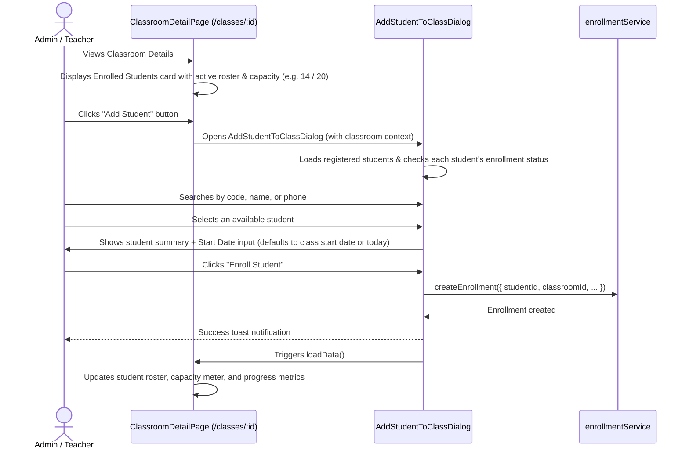

# Implementation Plan: Add Existing Students to Class from Class Details Page

**Status:** Implemented  
**Author:** AI Agent (Pair Programming)  
**Date:** 2026-10-17  
**Target Feature:** Classroom Management — Enrolled Students Roster & Add Student Modal  
**Reference Documents:** `AGENTS.md`, `docs/PROJECT.md`, `docs/ARCHITECTURE.md`, `docs/DESIGN-SYSTEM.md`

---

## 1. Executive Summary & Goals

On the **Class Details** page ([`ClassroomDetailPage`](file:///Users/noii/Documents/work/dambang/esd_attendance/src/pages/classes/classroom-detail-page.tsx)), administrators and teachers can review class metadata, schedule, instructor, and capacity metrics. However:
1. **No student list is displayed on the page**: The page shows an enrollment count (e.g. `12 / 20`), but staff cannot see which students are in the class.
2. **No direct way to add students**: To enroll a student, staff must leave the class view, navigate to the Student list, locate the student, open the Student Detail page, and click "Enroll in Class".

This feature adds:
1. An **Enrolled Students** roster card directly on the Class Details page, displaying all currently enrolled students with photos, codes, names, contact info, enrollment dates, and status.
2. An **"Add Student"** action button on the Class Details page that opens an **Add Student to Class** modal dialog.
3. A search-and-select student picker that inspects each student's current enrollment status (identifying available students, students already in this class, and students active in other classes), preventing duplicate enrollments and respecting class capacity constraints.

---

## 2. Technical Stack & Architecture

### Existing Domain Model & Relationship
- **`Classroom`** ([`src/models/classroom.model.ts`](file:///Users/noii/Documents/work/dambang/esd_attendance/src/models/classroom.model.ts)): Represents the class session/batch (`capacity`, `packageId`, `startDate`, `expectedEndDate`, `status`).
- **`Student`** ([`src/models/student.model.ts`](file:///Users/noii/Documents/work/dambang/esd_attendance/src/models/student.model.ts)): Registered student record (`studentCode`, `nameKh`, `nameEn`, `gender`, `phone`, `status`).
- **`Enrollment`** ([`src/models/enrollment.model.ts`](file:///Users/noii/Documents/work/dambang/esd_attendance/src/models/enrollment.model.ts)): The join record linking a `studentId` with a `classroomId` and `packageId`, tracking `startDate`, `expectedEndDate`, and `status: "active" | "completed" | "paused" | "cancelled" | "transferred"`.

### Existing Service Rules to Reuse
- [`enrollmentService.getActiveEnrollmentsByClassroomId(classroomId)`](file:///Users/noii/Documents/work/dambang/esd_attendance/src/services/enrollment.service.ts#L139): Retrieves all active enrollments for the class.
- [`enrollmentService.createEnrollment(data, currentUserId)`](file:///Users/noii/Documents/work/dambang/esd_attendance/src/services/enrollment.service.ts#L165):
  - Validates that the student does not already have an active enrollment (`ACTIVE_ENROLLMENT_EXISTS`).
  - Validates that the class exists and is active (`CLASSROOM_NOT_ACTIVE`).
  - Validates that the class capacity is not exceeded (`CLASS_CAPACITY_FULL`).
  - Automatically copies `packageId`, `startDate`, and `expectedEndDate` from the classroom if not specified.
  - Generates Firestore document and updates local fallback cache.
- [`enrollmentService.updateEnrollment(id, updates, currentUserId)`](file:///Users/noii/Documents/work/dambang/esd_attendance/src/services/enrollment.service.ts#L235): For changing enrollment status (e.g. marking completed or cancelling).

---

## 3. UI/UX Flow & Component Architecture

### User Flow

### Component Details

#### A. Enrolled Students Card on `ClassroomDetailPage`
- **Location:** Below the Class Details grid and Learning Progress card.
- **Header:**
  - Icon & Title: `Users` icon + "Enrolled Students" / "សិស្សក្នុងថ្នាក់".
  - Capacity badge: e.g. `14 / 20 Students (70%)` with progress tint.
  - Primary Action: **"Add Student"** / **"បន្ថែមសិស្សចូលថ្នាក់"** button (`UserPlus` icon).
    - *Disabled state:* If classroom status is not `"active"`, or if class capacity is full (with clear tooltip indicator).
- **Roster Table / List:**
  - Columns: `#`, `Student Photo & Name (Kh/En)`, `Code`, `Gender`, `Phone`, `Enrollment Date`, `Enrollment Status`, `Actions`.
  - Actions dropdown / buttons:
    - **View Profile:** Navigates to `/students/:id`.
    - **Change Status:** Mark completed, pause, or drop/cancel enrollment with confirmation.
- **Empty State:**
  - Clean card with `Users` icon and "No students enrolled yet. Click 'Add Student' to enroll students from your roster."

#### B. `AddStudentToClassDialog` Component
- **Component Path:** `src/components/classes/add-student-to-class-dialog.tsx`
- **Props:**
  - `open: boolean`
  - `onOpenChange: (open: boolean) => void`
  - `classroom: Classroom`
  - `onSuccess: () => void`
- **Dialog Features:**
  1. **Class Header Context:** Displays class name, code, schedule, and spots remaining (e.g., `6 spots left`).
  2. **Search Toolbar:** Real-time search across student code, Khmer name, English name, and phone number.
  3. **Filter Toggle:** "All Students", "Available for Enrollment", "Already Enrolled".
  4. **Student Selection List:**
     - Shows student avatar, name (Kh/En), code, and status.
     - **Availability Badges:**
       - `Available` (Green badge): Student is active and not enrolled in any class. Selectable.
       - `Already in this class` (Slate/Navy badge): Disabled.
       - `In another class: [Class Name]` (Amber badge): Disabled (explains that a transfer is required).
  5. **Enrollment Details (Step 2 / Side-by-side or below selection):**
     - Selected Student Preview Card.
     - Start Date (`<Input type="date">`, defaults to `classroom.startDate` or current date).
     - Optional Note (`<Input>` or `<Textarea>`).
  6. **Footer Actions:**
     - "Cancel" button.
     - "Enroll Student" primary button (submits write).
     - Option: "Enroll & Add Another" button for quick sequential enrollments.

---

## 4. Duplicate & Capacity Handling Strategy

1. **Class Capacity Check:**
   - If `classroom.capacity` is defined (e.g. 20) and `activeEnrollmentCount >= capacity`, the "Add Student" button is disabled and a warning banner indicates the class is full.
   - The service independently throws `CLASS_CAPACITY_FULL` as an extra safeguard.
2. **Student Double-Enrollment Prevention:**
   - Students currently active in this class are visually flagged as `Already in this class` and cannot be selected.
   - Students currently active in another class are visually flagged as `Active in [Other Class]` and cannot be selected directly, preserving historical transfer audit trails.
3. **Class Inactive Check:**
   - If the classroom is completed, paused, or cancelled, new enrollments are prevented.

---

## 5. Affected Files & Proposed Changes

| File | Action | Description |
|---|---|---|
| [`src/components/classes/add-student-to-class-dialog.tsx`](file:///Users/noii/Documents/work/dambang/esd_attendance/src/components/classes/add-student-to-class-dialog.tsx) | **Create** | Dedicated student picker and enrollment dialog with search, availability badges, start date picker, and service submission. |
| [`src/components/classes/enrolled-students-card.tsx`](file:///Users/noii/Documents/work/dambang/esd_attendance/src/components/classes/enrolled-students-card.tsx) | **Create** | Reusable card component displaying the classroom student roster table, status badges, and "Add Student" trigger. |
| [`src/pages/classes/classroom-detail-page.tsx`](file:///Users/noii/Documents/work/dambang/esd_attendance/src/pages/classes/classroom-detail-page.tsx) | **Update** | Fetch classroom enrollments and student details on load, embed `EnrolledStudentsCard`, and wire up `AddStudentToClassDialog`. |
| [`src/i18n/locales/en.json`](file:///Users/noii/Documents/work/dambang/esd_attendance/src/i18n/locales/en.json) | **Update** | Add English translation strings for enrolled students card and selection dialog under `classes.students.*`. |
| [`src/i18n/locales/km.json`](file:///Users/noii/Documents/work/dambang/esd_attendance/src/i18n/locales/km.json) | **Update** | Add matching Khmer translation strings under `classes.students.*`. |
| [`test/add-student-to-class.test.ts`](file:///Users/noii/Documents/work/dambang/esd_attendance/test/add-student-to-class.test.ts) | **Create** | Unit tests for student availability computation, capacity enforcement, and search filtering. |

---

## 6. Testing & Validation Plan

1. **Unit Testing (`npm test`):**
   - Test availability filter: students with active enrollment in target class, students with active enrollment in other class, and free students.
   - Test capacity threshold logic: class at capacity vs class with open seats.
   - Test search filtering by code, Khmer name, and phone.
2. **Integration & Workflow Testing:**
   - Open Class Details page (`/classes/:id`).
   - Verify active roster shows all enrolled students.
   - Click "Add Student", search and select an eligible student, confirm enrollment.
   - Verify roster updates, capacity counter increments, and progress metrics recalculate immediately.
   - Verify double-enrollment is rejected if attempting to add the same student again.
   - Verify "View Student" navigates to student details.
3. **Build & Type Checking (`npm run build`):**
   - Verify TypeScript passes with zero errors and production bundle builds successfully.

---

## 7. Bulk Multi-Select Upgrade (Completed)

Per feedback, the dialog was upgraded to support **Bulk Multi-Selection**:
- **Multi-select Checkboxes**: Each student row now features an accessible checkbox.
- **Select All Available / Deselect All**: Quick toggle in the selection toolbar selects all available candidates matching the active filter.
- **Remaining Capacity Safeguard**: Dynamically checks whether selected students count fits within remaining spots (`canEnrollCountInClassroom`). Displays an alert and disables the submission button if selection exceeds capacity.
- **Selected Student Chips**: Right column lists all chosen students with avatar, code, and quick remove buttons (`X`).
- **Atomic Batch Firestore Persistence**: Added `createEnrollments` to `enrollmentService` using `writeBatch(db)` chunked in batches $\le 450$.
- **Bilingual Translations**: Fully localized in English and Khmer with pluralization and capacity warning messages.
