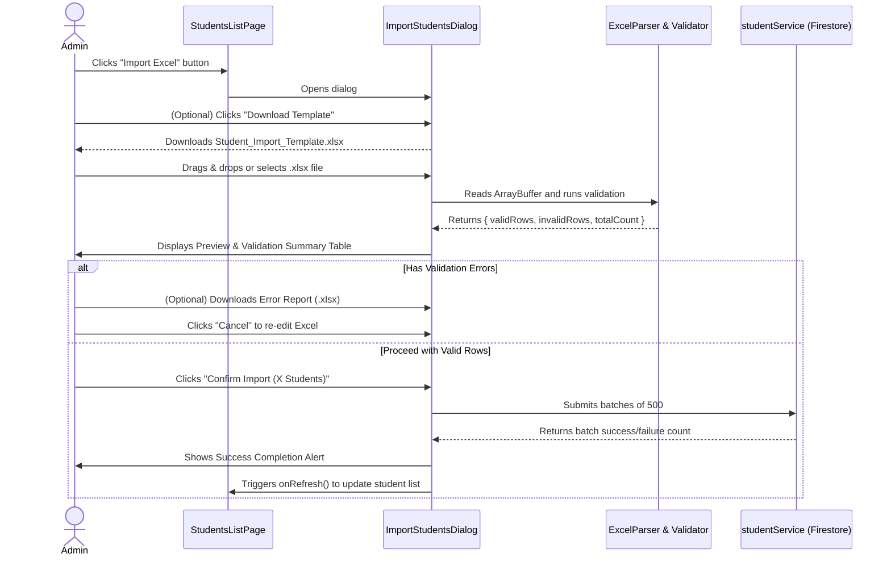

# Implementation Plan: Import Students from Excel

**Status:** Implemented  
**Author:** AI Agent (Pair Programming)  
**Date:** 2026-10-17  
**Target Feature:** Student Management — Bulk Import Students via Excel  
**Reference Documents:** `AGENTS.md`, `docs/PROJECT.md`, `docs/ARCHITECTURE.md`, `docs/DESIGN-SYSTEM.md`

---

## 1. Executive Summary & Goals

The School Management & Attendance system currently requires administrators to register students one-by-one through the manual web form (`/students/new`). At the beginning of a school term or course cycle, this causes significant administrative overhead.

This feature introduces an **"Import Excel"** workflow into the student management module ([`StudentsListPage`](file:///Users/noii/Documents/work/dambang/esd_attendance/src/pages/students/students-list-page.tsx)), enabling school administrators to:
1. Download a pre-formatted bilingual Excel template (.xlsx) with built-in column validation guidelines and example records.
2. Drag-and-drop or upload their completed student roster.
3. Review an in-browser preview table that validates every row and cell prior to persistence.
4. Inspect row-level error messages (missing required fields, malformed dates, invalid gender or phone values, and duplicate student codes).
5. Bulk persist validated student records to Cloud Firestore in safe atomic batches (up to 500 operations per batch) with progress tracking.
6. Download an Excel error report for any skipped/failed rows for easy correction and re-upload.

---

## 2. Technical Stack & Dependency Analysis

### Excel Processing Library
- **Existing Dependency:** `exceljs` (`^4.4.0`) is already present in [`package.json`](file:///Users/noii/Documents/work/dambang/esd_attendance/package.json) and actively used for monthly attendance report generation ([`attendance-report-excel.ts`](file:///Users/noii/Documents/work/dambang/esd_attendance/src/lib/attendance-report-excel.ts)).
- **File Format Compatibility:**
  - **`.xlsx` (Office Open XML):** 100% natively supported in the browser by `exceljs` using `workbook.xlsx.load(arrayBuffer)` and `workbook.xlsx.writeBuffer()`. Zero additional bundle overhead.
  - **`.xls` (Legacy Excel 97-2004 BIFF8 format):** `exceljs` does **not** natively parse binary `.xls` files. Supporting `.xls` directly in-browser would require introducing an external library such as `xlsx` (SheetJS), which adds ~300KB to the client bundle and introduces duplicate spreadsheet libraries.
  - **Recommendation:** Accept `.xlsx` as the primary standard format. If a user drops a `.xls` file, display a clear, helpful message instructing them to save/export the file as `.xlsx` (or provide the official `.xlsx` template).

---

## 3. Excel Template Specification & Column Mapping

The downloadable Excel template will feature:
- **Sheet 1 ("Students" / "បញ្ជីសិស្ស"):** The data table with styled bilingual headers and an example row.
- **Sheet 2 ("Instructions" / "សេចក្តីណែនាំ"):** Field descriptions, permitted values, and date format instructions.

### Data Column Mapping

| Col # | Header (Khmer) | Header (English) | Model Field | Required? | Accepted Values / Format | Example |
|---|---|---|---|---|---|---|
| 1 | **អត្តលេខសិស្ស** | **Student Code** | `studentCode` | **Yes** | String, unique, non-empty | `STU-001` |
| 2 | **គោត្តនាម និងនាម** | **Khmer Full Name** | `nameKh` | **Yes** | String, non-empty | `សុខ សាន` |
| 3 | **ឈ្មោះជាឡាតាំង** | **English Full Name** | `nameEn` | No | String | `Sok San` |
| 4 | **ភេទ** | **Gender** | `gender` | **Yes** | `ប្រុស` / `ស្រី`, `Male` / `Female`, `M` / `F` | `ប្រុស` |
| 5 | **ថ្ងៃខែឆ្នាំកំណើត** | **Date of Birth** | `dateOfBirth` | No | `YYYY-MM-DD` or Excel Date format | `2008-04-12` |
| 6 | **លេខទូរស័ព្ទសិស្ស** | **Student Phone** | `phone` | No | Numeric / phone string | `012345678` |
| 7 | **សំបុត្រកំណើត** | **Birth Certificate** | `birthCertificateStatus` | No | `មាន` / `has_certificate`, `គ្មាន` / `no_certificate` (Default: `has_certificate`) | `មាន` |
| 8 | **ភូមិ** | **Village** | `address.village` | No | String | `ស្វាយប៉ោ` |
| 9 | **ឃុំ/សង្កាត់** | **Commune** | `address.commune` | No | String | `ស្វាយប៉ោ` |
| 10 | **ក្រុង/ស្រុក/ខណ្ឌ** | **District** | `address.district` | No | String | `ក្រុងបាត់ដំបង` |
| 11 | **រាជធានី/ខេត្ត** | **Province** | `address.province` | No | String (Default: `បាត់ដំបង`) | `បាត់ដំបង` |
| 12 | **ឈ្មោះឪពុក** | **Father Name** | `fatherName` | No | String | `សុខ ផល` |
| 13 | **មុខរបរឪពុក** | **Father Occupation** | `fatherOccupation` | No | String | `អាជីវករ` |
| 14 | **ទូរស័ព្ទឪពុក** | **Father Phone** | `fatherPhone` | No | Numeric / phone string | `012998877` |
| 15 | **ឈ្មោះម្តាយ** | **Mother Name** | `motherName` | No | String | `កែវ ណារ៉ា` |
| 16 | **មុខរបរម្តាយ** | **Mother Occupation** | `motherOccupation` | No | String | `មេផ្ទះ` |
| 17 | **ទូរស័ព្ទម្តាយ** | **Mother Phone** | `motherPhone` | No | Numeric / phone string | `096778899` |
| 18 | **ស្ថានភាពសិស្ស** | **Status** | `status` | No | `សកម្ម` / `active`, `អសកម្ម` / `inactive`, `បណ្ណសារ` / `archived` (Default: `active`) | `active` |
| 19 | **កំណត់សម្គាល់** | **Note** | `note` | No | String | `សិស្សផ្ទេរមកពីសាលាផ្សេង` |

---

## 4. Validation Rules & Duplicate Handling Strategy

### A. File-Level Validation
1. **File Type:** Validate MIME type (`application/vnd.openxmlformats-officedocument.spreadsheetml.sheet`) and `.xlsx` extension.
2. **File Size Limit:** Maximum 5 MB (protects browser memory from freezing on malformed spreadsheets).
3. **Empty File Check:** Ensure workbook contains at least one worksheet and at least one data row beyond the header.
4. **Header Integrity:** Verify that the required columns (`studentCode`, `nameKh`, `gender`) are present in row 1.

### B. Row & Field-Level Validation
1. **Required Fields:**
   - `studentCode`: Non-empty after trimming.
   - `nameKh`: Non-empty after trimming.
   - `gender`: Permitted tokens normalized:
     - Male: `"male"`, `"m"`, `"ប្រុស"` -> maps to `"male"`
     - Female: `"female"`, `"f"`, `"ស្រី"` -> maps to `"female"`
     - Any other value triggers a validation error: `"INVALID_GENDER"`.
2. **Date Format (`dateOfBirth`):**
   - If provided, parse Excel serial dates (e.g., `39550`) or text strings (`YYYY-MM-DD`, `DD/MM/YYYY`, `DD-MM-YYYY`).
   - Must normalize to ISO string `YYYY-MM-DD`. If unparseable or date is in the future, trigger `"INVALID_DOB"`.
3. **Phone Numbers (`phone`, `fatherPhone`, `motherPhone`):**
   - Clean whitespace and format as standard string (preserve leading zero if numeric in Excel e.g. `12345678` -> `"012345678"`).
4. **Enums Normalization:**
   - `birthCertificateStatus`: `"has_certificate"` (default) or `"no_certificate"`.
   - `status`: `"active"` (default), `"inactive"`, or `"archived"`.

### C. Duplicate Handling Strategy
Duplicate `studentCode` is the primary integrity risk:
1. **File-Internal Duplicates:**
   - A single Excel file containing the same `studentCode` across multiple rows (e.g. Row 2 and Row 15 both use `STU-001`).
   - *Rule:* Flag both occurrences as errors (`DUPLICATE_CODE_IN_FILE`), preventing conflicting records from being imported.
2. **Database Duplicates (Existing System Records):**
   - Query all existing student codes from Firestore / cache upfront in a single batch read.
   - Any row in the Excel matching an existing student code is flagged as an error (`STUDENT_CODE_ALREADY_EXISTS`).
   - *Policy:* **Never silently overwrite existing students.**
   - *User Option:* The administrator can choose:
     - **Option A (Default):** Import only valid non-duplicate rows (skipping error rows).
     - **Option B:** Cancel and fix the Excel sheet first.

---

## 5. UI/UX Flow & Component Architecture

### User Flow Diagram


### Dialog Steps / Views
1. **Step 1: Upload & Download Template**
   - Banner with instructions and download link for `Student_Import_Template.xlsx`.
   - Drag-and-drop zone with animated upload icon and accepted file format badge (`.xlsx`).
2. **Step 2: Preview & Validation Table**
   - **Summary Stats Strip:**
     - Total Rows parsed.
     - Ready to Import (Green check badge).
     - Errors / Skipped (Red/Amber warning badge).
   - **Tabbed / Filterable Table:**
     - Toggle between "All Rows", "Valid Only", and "Errors Only".
     - Row highlights: green border for valid, red/rose background for rows with issues.
     - Inline popover / tooltip showing specific errors per cell.
   - **Action Bar:**
     - "Download Error Report" button (active if errors exist).
     - "Back to Upload" button.
     - "Cancel" button.
     - "Confirm Import (N Valid Students)" primary button.
3. **Step 3: Progress & Completion**
   - Progress bar during Firestore batch commit (`Saving 150 of 300...`).
   - Final status summary: "Successfully imported 280 students. 20 skipped."
   - "Done" button to close modal and refresh the table.

---

## 6. Firestore Persistence & Batching Strategy

### Firestore Technical Constraints
- `writeBatch(db)` allows a maximum of **500 operations per batch**.
- If an import has 1,200 students, it must be chunked into 3 batches: Batch 1 (500), Batch 2 (500), Batch 3 (200).

### Write Implementation in `studentService.importStudents()`
1. **Document ID Generation:**
   - Pre-generate IDs client-side using `doc(collection(db, "students")).id` so documents can be batched directly using `batch.set(docRef, studentPayload)`.
2. **Batch Chunking:**
   ```typescript
   const BATCH_SIZE = 450; // Safe threshold below 500 limit
   for (let i = 0; i < students.length; i += BATCH_SIZE) {
     const chunk = students.slice(i, i + BATCH_SIZE);
     const batch = writeBatch(db);
     chunk.forEach(student => {
       const docRef = doc(db, "students", student.id);
       batch.set(docRef, student);
     });
     await batch.commit();
     onProgress?.(Math.min(i + chunk.length, students.length), students.length);
   }
   ```
3. **Audit Fields:**
   - Every student created via import gets:
     - `createdAt`: ISO timestamp.
     - `updatedAt`: ISO timestamp.
     - `createdBy`: Current authenticated user's ID (`user?.id || "system"`).
     - `updatedBy`: Current authenticated user's ID (`user?.id || "system"`).
4. **Local Fallback Cache Sync:**
   - Upon successful Firestore commit, update `localStorage.getItem("esd_local_students")` to keep the offline/fallback cache in sync with the new students.

---

## 7. Affected Files & Proposed Architecture

| File Path | Action | Description |
|---|---|---|
| [`src/lib/student-import-excel.ts`](file:///Users/noii/Documents/work/dambang/esd_attendance/src/lib/student-import-excel.ts) | **Create** | Pure helper module using `exceljs` to:<br>1. Generate downloadable bilingual template workbook.<br>2. Parse `.xlsx` files into raw row objects.<br>3. Validate rows against domain rules and existing student codes.<br>4. Generate downloadable error report spreadsheet. |
| [`src/components/students/import-students-dialog.tsx`](file:///Users/noii/Documents/work/dambang/esd_attendance/src/components/students/import-students-dialog.tsx) | **Create** | The complete modal component containing file drop zone, validation preview table, progress bar, and error export. |
| [`src/services/student.service.ts`](file:///Users/noii/Documents/work/dambang/esd_attendance/src/services/student.service.ts) | **Update** | Add `importStudents(students: Omit<Student, "createdAt" | "updatedAt">[], onProgress?: ...)` supporting batch writes and local storage sync. |
| [`src/pages/students/students-list-page.tsx`](file:///Users/noii/Documents/work/dambang/esd_attendance/src/pages/students/students-list-page.tsx) | **Update** | Add "Import Excel" button (`FileSpreadsheet` or `Upload` icon) in the header next to "Add Student" and connect `ImportStudentsDialog`. |
| [`src/i18n/locales/en.json`](file:///Users/noii/Documents/work/dambang/esd_attendance/src/i18n/locales/en.json) | **Update** | Add complete English translations for dialog, table headers, validation errors, and buttons under `students.import.*`. |
| [`src/i18n/locales/km.json`](file:///Users/noii/Documents/work/dambang/esd_attendance/src/i18n/locales/km.json) | **Update** | Add equivalent Khmer translations for all import-related keys. |

---

## 8. Localization Strings to Add (Sample)

Keys will be nested under `"students.import"`:
- `button`: "Import Excel" / "នាំចូលតាម Excel"
- `title`: "Import Students from Excel" / "នាំចូលសិស្សតាមរយៈឯកសារ Excel"
- `description`: "Upload an Excel file (.xlsx) to bulk register students" / "បញ្ចូលឯកសារ Excel (.xlsx) ដើម្បីចុះឈ្មោះសិស្សច្រើនក្នុងពេលតែមួយ"
- `downloadTemplate`: "Download Excel Template" / "ទាញយកគំរូឯកសារ Excel"
- `dropzoneTitle`: "Click or drag & drop Excel file here" / "ចុច ឬទាញទម្លាក់ឯកសារ Excel នៅទីនេះ"
- `dropzoneHint`: "Supports .xlsx files up to 5MB" / "គាំទ្រឯកសារ .xlsx ទំហំអតិបរមា 5MB"
- `previewTitle`: "Data Validation & Preview" / "ការផ្ទៀងផ្ទាត់ និងមើលទិន្នន័យជាមុន"
- `totalRows`: "Total Rows: {{count}}" / "ចំនួនជួរសរុប: {{count}}"
- `validRows`: "Ready to Import: {{count}}" / "ត្រៀមនាំចូល: {{count}}"
- `invalidRows`: "Errors Found: {{count}}" / "មានកំហុស: {{count}}"
- `downloadErrorReport`: "Download Error Report" / "ទាញយករបាយការណ៍កំហុស"
- `confirmImport`: "Confirm Import ({{count}} Students)" / "បញ្ជាក់ការនាំចូល ({{count}} នាក់)"
- `importSuccess`: "Successfully imported {{count}} students" / "បាននាំចូលសិស្សចំនួន {{count}} នាក់ដោយជោគជ័យ"
- `errors.studentCodeRequired`: "Student Code is required" / "តម្រូវឱ្យមានអត្តលេខសិស្ស"
- `errors.nameKhRequired`: "Khmer Name is required" / "តម្រូវឱ្យមានឈ្មោះជាភាសាខ្មែរ"
- `errors.invalidGender`: "Gender must be Male or Female" / "ភេទត្រូវតែជា ប្រុស ឬ ស្រី"
- `errors.invalidDob`: "Invalid date format (must be YYYY-MM-DD)" / "ទម្រង់ថ្ងៃខែឆ្នាំកំណើតមិនត្រឹមត្រូវ (YYYY-MM-DD)"
- `errors.duplicateInFile`: "Duplicate Student Code in file" / "អត្តលេខសិស្សស្ទួនក្នុងឯកសារ"
- `errors.codeAlreadyExists`: "Student Code already exists in system" / "អត្តលេខសិស្សមានរួចហើយក្នុងប្រព័ន្ធ"

---

## 9. Testing & Quality Assurance Plan

1. **Validation & Parser Unit Scenarios:**
   - Standard valid file with 10 students (mix of full fields and minimal required fields).
   - Missing required fields (blank `studentCode` or blank `nameKh`).
   - Invalid `gender` values (e.g. "Other", numeric values, blank).
   - Varied date formats: Excel numeric date serials, text strings (`2008-05-15`, `15/05/2008`).
   - Duplicate `studentCode` within the same spreadsheet.
   - Duplicate `studentCode` matching an existing student already in the database.
   - Non-Excel file dropped (e.g. `.pdf`, `.png`) -> immediate rejection.
   - Oversized file (> 5MB) -> immediate rejection.
2. **Firestore Batch Scenarios:**
   - Import of 10 students (single batch).
   - Import of 600 students (verifying multi-batch chunking: 450 + 150).
   - Network disruption / simulated batch error handling: ensure UI reports actual saved count vs failed count without crashing.
3. **UI / Responsiveness / Localization:**
   - Test modal rendering on mobile, tablet, and desktop viewports.
   - Verify all Khmer and English labels fit without overlapping or breaking layout.
   - Test "Download Error Report" to confirm generated Excel opens cleanly in Microsoft Excel and Google Sheets.
4. **Build Verification:**
   - Execute `npm run build` (`tsc -b && vite build`) to ensure zero type or compilation regressions.

---

## 10. Open Questions for Project Owner Approval

1. **Handling Rows with Errors during Import:**
   - *Option A (Recommended):* Allow the administrator to import only the valid rows while downloading an error report for the skipped rows.
   - *Option B:* Block the entire import until the administrator fixes all errors in their Excel sheet and re-uploads.
   *(The plan currently defaults to Option A with an explicit confirmation dialog stating how many valid students will be imported and how many will be skipped).*
2. **Automatic Enrollment during Import:**
   - Should the Excel template optionally include a "Class Code" column (e.g. `CLS-001`) to automatically enroll imported students into a class, or should enrollment remain a separate step via the existing class management page?
   *(The plan recommends keeping student creation focused first, with class enrollment remaining modular, but can be added if desired).*
3. **Student Code Generation:**
   - If an Excel row leaves `studentCode` blank, should the system auto-generate one (e.g., `STU-xxx`), or should `studentCode` strictly remain a required field in the spreadsheet?
   *(The plan currently treats `studentCode` as required to prevent unexpected code assignment).*
